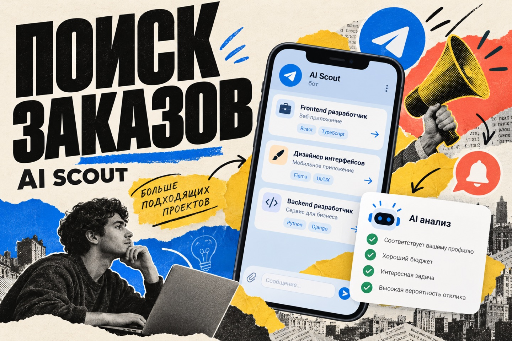

# Freelance AI Scout



A personal Telegram bot that monitors owner-approved channels for relevant freelance software projects and AI-assisted development roles. It filters posts, explains why an opportunity fits, and sends candidates to the owner. It can draft replies or send first applications automatically when the owner enables outreach.

## What it does

- Adds a public Telegram channel only after the owner confirms it in the bot's menu.
- Checks channels with positive owner feedback every 2 minutes, channels with unreviewed or useful alerts every 5 minutes, new channels every 10 minutes, and channels with no useful alerts for a week every 30 minutes. The priority channel is checked on new Telegram updates with a 30-second polling fallback. SQLite stores progress across restarts.
- Searches public chats by name and, when the user account permits it, public posts within Telegram's free search quota. It checks the quota, obeys FloodWait, and never authorizes Stars spending. New sources still require owner approval.
- Filters for concrete software tasks and realistic delivery with Codex plus manual verification. AI-assisted development need not appear in the client's post. One-time, recurring, and part-time work are enabled by default; full-time roles are off by default. Senior, DevOps, security, and explicitly office-only roles are held back.
- Recognizes Telegram contacts, hidden links, email, and application forms. Only confirmed free contact paths enter instant notifications; paid and unconfirmed paths do not fill the main feed. High-scoring posts with unconfirmed contact remain available under **Jobs → Check contact**. Audited platform sources remain paused by default and can be resumed with **Channels → Platforms**.
- Uses OpenRouter for structured analysis and sends every qualifying opportunity without a score threshold. Search queries are grouped and prioritized using observed source, job, application, and reply outcomes.
- Groups reposts when the contact or source supports the match, tracks rejection reasons and manual application statuses, shows 7-day, 30-day, and all-time analytics, and prepares reply drafts for owner review.
- Sends native interactive order cards with follow/unfollow, reply draft, analysis, source, rejection, status, note, and price actions. Analysis and drafts open in the same message; choices and edited drafts persist in SQLite. No Mini App, domain, or tunnel is required for these cards.

**Bot → Auto applications** shows the day's recipients, sent applications and incoming replies. Enable it there to contact a single listed personal Telegram account per new eligible job using the Telegram user session. The application includes the verified portfolio links. The bot alerts the owner when a tracked client replies and sends a daily report at 21:00 Yekaterinburg time. Set `OUTREACH_PORTFOLIO_URLS` to space-separated public HTTPS links to override the default portfolio.

## Stack

Python 3.11+, Telegram Bot API and a Telegram user session, OpenRouter, SQLite, SQLAlchemy, Alembic, Docker Compose, and pytest.

## Local setup

Create a Python environment, install dependencies, and copy the configuration template:

```bash
python3 -m venv .venv
source .venv/bin/activate
pip install -e '.[dev]'
cp .env.example .env
```

Set the required values in `.env`:

| Variable | Purpose |
| --- | --- |
| `BOT_TOKEN` | Telegram bot token from BotFather |
| `OWNER_ID` | Numeric Telegram ID allowed to control the bot |
| `TELEGRAM_API_ID`, `TELEGRAM_API_HASH` | Credentials for reading channels with a Telegram user account |
| `OPENROUTER_API_KEY` | Key for candidate analysis |
| `OPENROUTER_MODEL` | Model/provider with JSON Schema structured output support |

The default `AI_PROVIDER=openrouter` keeps the existing OpenRouter setup. To try a separate
OpenAI-compatible endpoint, set `AI_PROVIDER=compatible`, `ALTERNATE_API_KEY`,
`ALTERNATE_API_BASE_URL` (HTTPS base ending in `/v1`), and `ALTERNATE_MODEL` in the
private `.env`. Switching back only requires `AI_PROVIDER=openrouter`. The alternative
requests structured JSON responses and validates them locally. Its token balance and spending
are **not** measured by the bot's OpenRouter USD limit; check them with the seller.
Set optional `ALTERNATE_DRAFT_MODEL` to use a separate model for reply drafts while keeping candidate analysis on `ALTERNATE_MODEL`.
Do not put either key in Git or screenshots. Verify the exact endpoint and model ID
before switching, then use the bot's **Check** menu and inspect a real analysis.
Automatic discovery is on by default. Search passes check all discovered chats without a separate model-call cap.
Telegram's free search quota still determines when discovery pauses and resumes. Channel monitoring stays active independently.

The optional `TELEGRAM_PHONE` is used for the first interactive login. Keep `.env` and the resulting Telegram session private. Then authorize the user account and start the bot:

```bash
python -m scout.auth
python -m scout.main
```

Only one instance should poll the Bot API with a given token at a time.

## Docker Compose

For a server deployment, provide a private `.env` and create the Telegram user session interactively before starting the service:

```bash
docker compose build
docker compose run --rm scout python -m scout.auth
docker compose up -d
docker compose logs -f scout
```

The named `scout_data` volume holds the SQLite database and Telegram session. Preserve it during updates.

## Using the bot

Send `/start` to show the bottom menu. Tap a section to switch the keyboard to its actions; use **Back** to return. **Jobs → Following** opens saved orders; following is independent of the application status. **Latest** and **Best** show buttons that open each order's card. In a card, **Reply** prepares and saves a draft, **Analysis** opens the plan, and **Back to order** restores the main buttons. **Note / price** and **Edit reply** ask for text in the chat and update the original card; **Cancel input** leaves the saved value unchanged. **Channels → By channel** shows seven-day post, alert, and response counts, check times, and the current polling interval for every source. **Channels** also includes **Find chats now** and **Search performance**. **Bot → Settings** toggles employment categories and search groups; **Bot → Applications** shows analytics. To add a channel, send a public `@username` or `t.me` link and confirm **Add** on its card. Commands include `/status`, `/sources`, `/channelstats`, `/pending`, `/latest`, `/top`, `/stats`, `/analytics`, `/outreach`, `/settings`, and `/add`.

## Mini App interface preview

The owner-selected dark interface is in [`miniapp/`](miniapp/README.md). Open
`miniapp/index.html` for the mobile overview, job card, reply draft, and channel
controls. Outside Telegram it shows an explicitly labeled browser-only demo.
The optional aiohttp server uses Telegram-signed, owner-only authentication to
connect the interface to the bot's existing database and services. Enable it with
`MINIAPP_ENABLED=true`; it listens on `127.0.0.1:8080` by default, in the same
process as the bot. Set `MINIAPP_URL` to a public HTTPS origin to configure the
owner's Telegram menu button. Hosting or a tunnel must be configured separately.

## Tests

The owner can try a fictional notification sample generated with
`scout.demo_widget.widget_text()` and `widget_keyboard()`. Its inline buttons
persist a separate demo choice, show details, and read the saved choice back.
The sample does not add jobs or channels to monitoring.

```bash
pytest -q
```

The app applies Alembic migrations at startup. A manual `alembic upgrade head` uses the database path in `alembic.ini`; the app itself reads `DATABASE_URL` from `.env`.

## Notes

- Some public channels restrict history access. The bot logs those errors and retains its stored cursor.
- OpenRouter spending estimates depend on the cost data reported by the provider.
- A rare duplicate notification is possible if the process stops between a Telegram send and the database update.
- Live Telegram and OpenRouter access requires your own credentials and cannot be verified by the test suite.

This repository contains application code and configuration examples only. Do not commit `.env`, Telegram sessions, databases, SSH keys, or VPN configuration.
