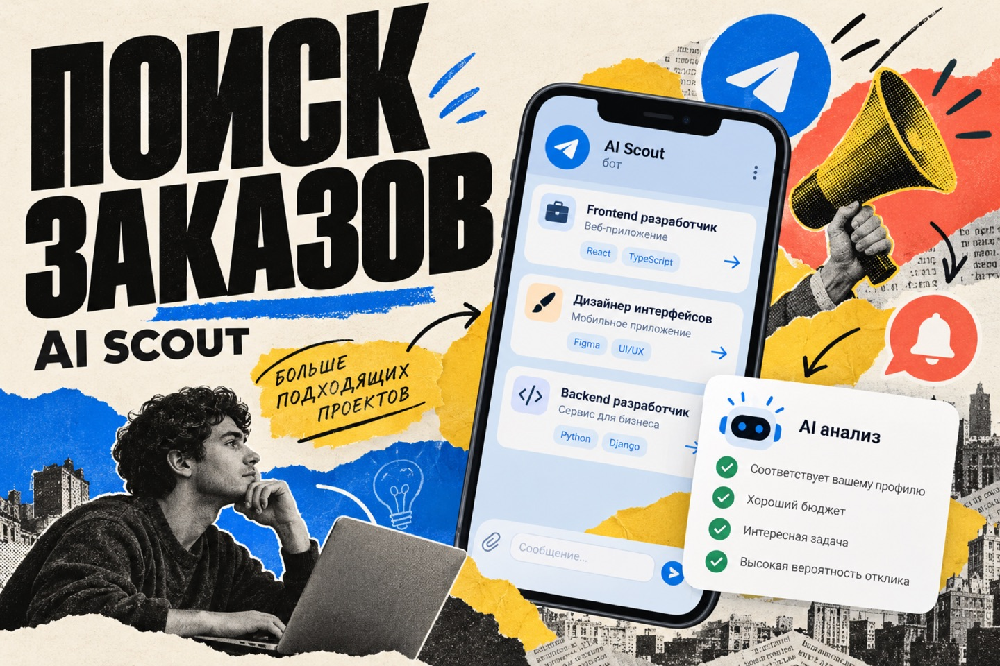

# Freelance AI Scout



A personal Telegram bot that monitors owner-approved channels for relevant freelance software projects and AI-assisted development roles. It filters posts, explains why an opportunity fits, and sends candidates to the owner. It can draft a reply, but never contacts clients on its own.

## What it does

- Adds a public Telegram channel only after the owner confirms it in the bot's menu.
- Checks approved channels every 10 minutes and stores progress in SQLite so posts can be processed across restarts.
- Uses Telegram's free global post searches to find public channels with recent software requests and a direct Telegram contact, then screens source activity within three days and sends candidates in review digests of up to five chats. It checks the remaining free quota and resumes when Telegram says it resets; it never authorizes Stars spending.
- Filters out unrelated remote jobs and posts without a concrete software task. One-off software projects do not need to mention AI. Ongoing roles must explicitly involve AI-assisted development.
- Pauses audited sources without direct replies and skips posts without a direct Telegram contact before AI analysis. The owner can resume them with **Channels → Platforms**; monitoring starts at fresh posts when re-enabled.
- Uses OpenRouter for structured analysis of candidate posts and delivers every qualifying opportunity with a direct contact without a score threshold.
- Groups exact and similar reposts, supports feedback, and prepares reply drafts for the owner's review.

The bot does not join channels on its own or send applications to clients.

## Stack

Python 3.11+, Telegram Bot API and a Telegram user session, OpenRouter, SQLite, SQLAlchemy, Alembic, Docker Compose, and pytest.

## Local setup

Create a Python environment, install dependencies, and copy the configuration template:

```bash
python3 -m venv .venv
source .venv/bin/activate
pip install -e '.[dev]'
cp .env.example .env
```

Set the required values in `.env`:

| Variable | Purpose |
| --- | --- |
| `BOT_TOKEN` | Telegram bot token from BotFather |
| `OWNER_ID` | Numeric Telegram ID allowed to control the bot |
| `TELEGRAM_API_ID`, `TELEGRAM_API_HASH` | Credentials for reading channels with a Telegram user account |
| `OPENROUTER_API_KEY` | Key for candidate analysis |
| `OPENROUTER_MODEL` | Model/provider with JSON Schema structured output support |

The default `AI_PROVIDER=openrouter` keeps the existing OpenRouter setup. To try a separate
OpenAI-compatible endpoint, set `AI_PROVIDER=compatible`, `ALTERNATE_API_KEY`,
`ALTERNATE_API_BASE_URL` (HTTPS base ending in `/v1`), and `ALTERNATE_MODEL` in the
private `.env`. Switching back only requires `AI_PROVIDER=openrouter`. The alternative
requests structured JSON responses and validates them locally. Its token balance and spending
are **not** measured by the bot's OpenRouter USD limit; check them with the seller.
Do not put either key in Git or screenshots. Verify the exact endpoint and model ID
before switching, then use the bot's **Check** menu and inspect a real analysis.
Automatic discovery is off by default. A manual **Find chats now** run is capped at
`DISCOVERY_AI_CALL_LIMIT=10` model calls; the next button press continues with the
next search phrase. Channel monitoring stays active independently of this limit.

The optional `TELEGRAM_PHONE` is used for the first interactive login. Keep `.env` and the resulting Telegram session private. Then authorize the user account and start the bot:

```bash
python -m scout.auth
python -m scout.main
```

Only one instance should poll the Bot API with a given token at a time.

## Docker Compose

For a server deployment, provide a private `.env` and create the Telegram user session interactively before starting the service:

```bash
docker compose build
docker compose run --rm scout python -m scout.auth
docker compose up -d
docker compose logs -f scout
```

The named `scout_data` volume holds the SQLite database and Telegram session. Preserve it during updates.

## Using the bot

Send `/start` to show the four-button menu: **Jobs**, **Channels**, **Add channel**, and **Bot**. Tap a section to switch the bottom keyboard to its actions; use **Back** to return. The bot keeps the message that carries the keyboard and removes your navigation tap from the chat. **Channels** includes **Find chats now**, which requests a search while free quota remains. To add a channel, send a public `@username` or `t.me` link and confirm **Add** on its card. Commands include `/status`, `/sources`, `/pending`, `/latest`, `/top`, `/stats`, `/settings`, and `/add`.

## Tests

```bash
pytest -q
```

The app applies Alembic migrations at startup. A manual `alembic upgrade head` uses the database path in `alembic.ini`; the app itself reads `DATABASE_URL` from `.env`.

## Notes

- Some public channels restrict history access. The bot logs those errors and retains its stored cursor.
- OpenRouter spending estimates depend on the cost data reported by the provider.
- A rare duplicate notification is possible if the process stops between a Telegram send and the database update.
- Live Telegram and OpenRouter access requires your own credentials and cannot be verified by the test suite.

This repository contains application code and configuration examples only. Do not commit `.env`, Telegram sessions, databases, SSH keys, or VPN configuration.
